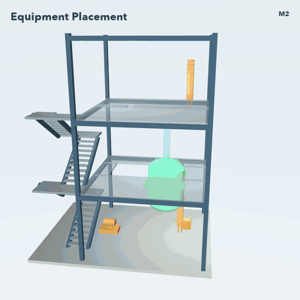
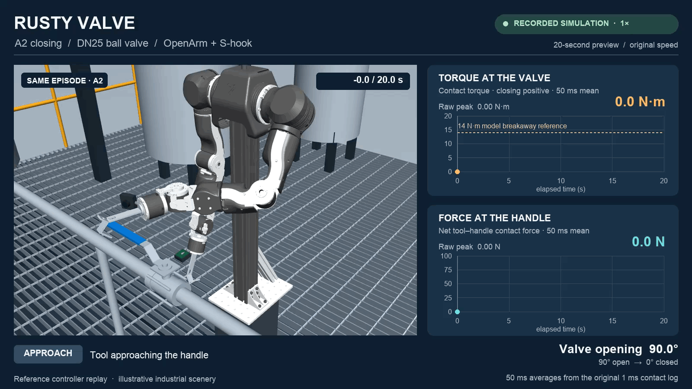

# Rusty Valve

**Training robot field operators for chemical plants.**

Rusty Valve is an open simulation project for robots that operate manual valves in refineries and chemical plants. We model real valves with their resistance, generate plant rooms full of them, and score any robot with the same public exam. Everything here is free to download, run, and build on.



*Replay of one generation run from the room-12 process recipe: equipment placement, pipe routing, valve fitting, then insulation, platforms, and stairs.*

| | What is here | Start |
|---|---|---|
| **Valves** | 17 ball-valve models, DN15–DN200, with lever or gear-operated handwheel and opening and closing resistance curves. | [Valve library](models/valves/README.md) |
| **Rooms** | 15 chemical plant rooms with reactors, vessels, pumps, heat exchangers, pipes, insulation, platforms, and 304 installed manual valves. A generator builds new rooms from process recipes. | [Browse rooms](models/scenes/chemical-plant-rooms/README.md) · [Generate a room](models/scenes/chemical-plant-rooms/README.md#generate-your-own-room) |
| **Platforms** | MuJoCo 3.16 and Isaac Sim 6.2.0 with OpenUSD. The room and valve pages describe what was tested. | [Quick start](#quick-start) |

## Why robots, and why manual valves

- **Most valves in a plant are manual.** An actuated valve can cost up to ten times as much, so plants put them only where control requires them. In the units we worked in, we estimate 80–90% of valves were manual.
- **Actuated valves still need manual ones.** Isolation for maintenance, draining, and replacing a leaking flange all depend on manual valves on either side.
- **Much of the work is local.** Starting a pump against a closed discharge valve, releasing pressure after a test, and taking a sample are done by a person standing at the valve.
- **In an emergency, the manual valve is the last shutoff.** During a fire, a power loss, or a toxic leak, someone has to walk into the hazard and close it. Valves above 2 m also need a work-at-height permit, and emergencies do not wait for one.
- **It is hard for robots.** Valves sit among pipes, platforms, and insulation. Turning one takes sustained force through contact, a body braced against the reaction, and a feel for when the valve has reached its stop.

[Why we started this project: the founder's story](docs/story.md)

## Operate a valve



*Closing a DN25 ball valve through physical contact, with contact torque and tool–handle force from the same simulation. The 14 N·m line is the model breakaway reference. The industrial backdrop is illustrative.*

[Level 1](levels/01-handle-ball-valve/) has six installations of one valve: horizontal or vertical pipe, stem up or facing the operator. Any robot, end-effector, or method takes the same [Public Exam v1](levels/01-handle-ball-valve/#public-exam-v1):

1. Hold the valve within 5° of its stop for the final second.
2. No environment contact above 20 N. The handle is free to touch.
3. Finish within 90 seconds.

The valve must move through contact. Records that overwrite the valve state are invalid.

## Demonstrations and learning

| Method | Inputs | Test | Passed |
|---|---|---|---|
| Teacher, OpenArm + S-hook | Privileged simulator state | Standard A1/A2 open and close, clean macOS install | 4 / 4 |
| ACT, round 1 | Head + wrist images, joint angles | Valve positions seen in training | 1 / 4 |
| ACT, round 1 | Same | Unseen positions, some with new colors and lighting | 0 / 12 |
| ACT, round 2 | Same, 300 valve positions in training | Unseen positions | 0 / 36 |

The [teacher](docs/teacher.md) is a scripted controller for OpenArm with a fixed [S-hook](hardware/s-hook/). It generated 646 demonstrations ([dataset](docs/dataset_card.md)). ACT has not solved Level 1: with more valve positions it engages the handle and turns the valve more often, but typical failures still lose contact near the end of closing. [Full report](docs/act_baseline.md)

## Quick start

Run the teacher and score its recording:

```sh
python3.12 -m venv .venv && . .venv/bin/activate
python -m pip install ./runtime
rusty-valve teacher --task A2_close --output ./teacher_A2_close
rusty-valve score ./teacher_A2_close/physical_step_evidence.jsonl.gz --output ./public_score.json
```

Open a downloaded room with its valve resistance:

```sh
cd room-12
python -B run_room.py            # macOS viewer: mjpython -B run_room.py
```

[Runtime and downloads](runtime/README.md) · [Hugging Face](https://huggingface.co/rusty-valve) · [Rooms](models/scenes/chemical-plant-rooms/README.md#use-a-ready-made-room) · [Valves](models/valves/README.md)

## Next

Put robot motion into the rooms: generate whole-body motion for Unitree G1, execute it under physical contact, and score it with the same exam. [Roadmap](docs/roadmap.md)

## Contribute

- **Worked in a plant?** [Share a valve installation](CONTRIBUTING.md): size or model, plus photos, sketches, or a description. Remove plant names, equipment tags, and faces.
- **Build robots?** Adapt your robot through the [runtime interface](runtime/README.md#robottask-api), run the exam, and share the score.

## License

Apache-2.0 for our code, models, and ACT weights. CC BY 4.0 for our data, exam records, text, and illustrations. The founder's story is excluded. Third-party material keeps its own terms. [License scope](LICENSING.md) · [Third-party notices](THIRD_PARTY_NOTICES.md)
