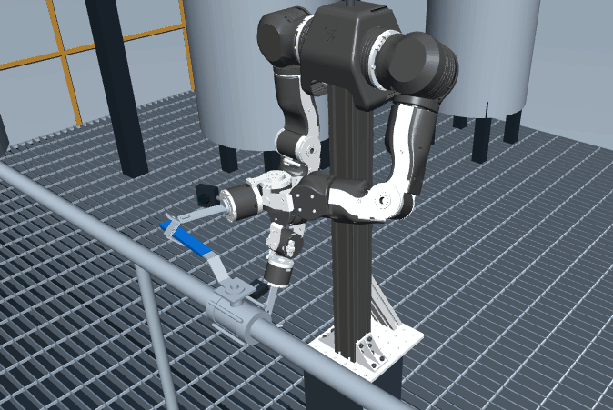

# Rusty Valve

**Training robot field operators for chemical plants.**



*A2 closing replay from the reference controller. The industrial backdrop is illustrative.*

[Level 1: Handle ball valve](levels/01-handle-ball-valve/) · [MuJoCo station models](models/scenes/handle-ball-valve-stations/) · [ACT training records and weights](models/#act-training-records-and-checkpoint-downloads) · [S-hook tool](hardware/s-hook/) · [Dataset description](docs/dataset_card.md) · [ACT results](docs/act_baseline.md) · [Climbing preview](docs/climbing.md) · [Hugging Face organization](https://huggingface.co/rusty-valve) · [Why we built this](docs/story.md)

Rusty Valve is developing an open simulation benchmark for manual valve operation in refineries and fine-chemical plants. The project includes valve stations, a common scoring program, a scripted "teacher" that generates demonstrations, a LeRobot-format dataset, and learning baselines. The public exam applies to any robot and end-effector. The teacher is a reference solution for OpenArm with an S-hook; users of another robot must write their own controller.

**Release v0.** This repository includes the runtime, standalone station models, S-hook design files, and benchmark summaries. The full datasets, ACT checkpoints, and raw exam records are separate materials. See [download and placement instructions](runtime/README.md#download-and-place-materials).

**v0 downloads** · [Four-task dataset](https://huggingface.co/datasets/rusty-valve/a1_a2_open_close_646) · [A2-closing coverage dataset](https://huggingface.co/datasets/rusty-valve/a2_close_300_positions) · [ACT round 1 checkpoint](https://huggingface.co/rusty-valve/a2_close_act_round1) · [ACT round 2 checkpoint](https://huggingface.co/rusty-valve/a2_close_act_round2) · [Original exam records](https://huggingface.co/datasets/rusty-valve/raw_exam_records_v0)

## What the project includes

| Component | What it is |
|---|---|
| **[Stations and valve models](models/)** | MuJoCo scenes of a DN25 handle ball valve in 6 installations: horizontal or vertical pipe, stem up or facing the operator. MJCF models and JSON parameters are separate from the robot model. A1 and A2 have opening and closing reference demonstrations; B1–C2 are challenge stations. The library will grow to include real-to-sim valves and small chemical-plant scenes. |
| **Exam** | Public Exam v1: endpoint and hold, no hard collision with the environment, and a 90-second cutoff. Applies to any robot and end-effector. Working-face checks are separate **S-tool-specific records** and do not affect the public result. |
| **Teacher** | A state-feedback reference solution for **OpenArm + S-hook**, using privileged simulator state. For another robot, write your own controller. See [How the demonstrations are made](docs/teacher.md). |
| **Dataset** | Two sets. **Four-task set:** 646 A1/A2 opening and closing demonstrations; ACT round 1 trained on its 256 A2-closing demonstrations. **A2-closing coverage set:** 300 demonstrations, each at a different valve position; used for ACT round 2. LeRobot format with three camera views, joint state/actions, and valve labels. [Contents and splits](docs/dataset_card.md). |
| **Learning baseline** | ACT learns from images and joint state. Results from two training rounds and their evaluation scope are listed below. Training records are included in this repository. ACT weights are separate release materials. |
| **Reference hardware** | OpenArm (bimanual, shoulder-mounted) with a fixed S-hook designed for SUS304 stainless steel. The [tool directory](hardware/s-hook/) explains why we chose it and includes the simulation drawing and parameters; manufacturing CAD is not yet included. |

## Public Exam v1

The same three rules apply to **any robot, any end-effector, and any method**, including scripts, learned policies, and teleoperation:

1. **Reach and hold the endpoint.** At the end of the operation or episode cutoff, the valve must be within 5° of the target stop and have stayed there continuously for the final 1 second or longer. Reaching it earlier and then moving out of the target region does not pass.
2. **No hard collision with the environment.** Any robot part contacting a pipe, support, valve body, or other non-handle environment object with an individual contact force above 20 N fails. Any robot part or surface may contact the handle. Robot self-contact, including between fingers or between a finger and palm, is recorded and does not count as a hard collision.
3. **90-second cutoff.** End the episode at 90 seconds if the operation has not finished, and assess its state at that cutoff.

Valve motion must come from physical robot contact. Records that directly overwrite the valve state are invalid. **S-tool-specific records**, such as orange/blue working-face checks, are reported separately and do not affect public pass/fail. The exam does not prescribe a hand, surface, pose, or technique.

## Experiment results

The results below were re-evaluated under Public Exam v1.

| Method | Inputs | Test | Public Exam v1 result |
|---|---|---|---|
| Teacher (reference), A1/A2 open and close | Privileged simulator state | Standard condition of each task, rerun on a clean macOS install | 4 / 4 |
| ACT, round 1, A2 close | Head + wrist images, joint angles | Valve positions used in training | 1 / 4 |
| ACT, round 1, A2 close | Head + wrist images, joint angles | Valve positions not used in training; some tests change colors and lighting | 0 / 12 |
| ACT, round 2, A2 close | Head + wrist images, joint angles | More valve positions not used in training; some tests change colors and lighting | 0 / 36 |

ACT has not solved Level 1. More scene coverage did help: on the 12 unseen-position and appearance tests shared by both rounds, runs that turned the valve more than 5° rose from 2 to 8, and runs that never engaged the handle fell from 4 to 0.

The ACT round-1 pass includes complete retraction. Valve-operation completion and retraction are recorded separately.

See [the ACT experiment report](docs/act_baseline.md) for both rounds and [Level 1](levels/01-handle-ball-valve/) for the task, settings, and success/failure videos.

## Quick start

```sh
python3.12 -m venv .venv && . .venv/bin/activate
python -m pip install ./runtime
rusty-valve teacher --task A2_close --output ./teacher_A2_close
rusty-valve score ./teacher_A2_close/physical_step_evidence.jsonl.gz --output ./public_score.json
```

Follow the [installation and run commands](runtime/README.md#installation-and-commands) to load a station, run an OpenArm + S-hook reference demonstration, and score its recording. These steps use files in this repository. Reading the datasets and running the ACT policies require the [complete local materials](runtime/README.md#material-layout). The [validation notes](runtime/VALIDATION.md) record the clean macOS CPU checks.

## How it works

**Teacher and student.** Our teacher is a reference solution for **OpenArm + S-hook**. It uses privileged simulator state and reviewed key poses through six phases: approach, engage, turn, hold, release, and retract. Each transition depends on the actual state. For another robot, you must write your own controller; changing the end-effector also requires tool-specific contact and control logic. See [How the demonstrations are made](docs/teacher.md). The student, ACT, learns from head and wrist images plus arm joint angles; it does not receive the true valve angle or contact force as policy inputs.

For demonstration generation, we encoded field technique in the teacher, then used imitation learning for ACT. See [Level 1](levels/01-handle-ball-valve/) for details.

## Curriculum

One course, valve operation, split into levels. Each level adds one new skill.

| Level | Skill | Status |
|---|---|---|
| 1 Handle ball valve | Reach and hold the open or closed endpoint without a hard collision with the environment | **v0** |
| 2 Handwheel valve | Multi-turn gate and globe valves, regrasping without stalling | Planned |
| 3 Tools and high torque | Valve wrench on handle-less valves; stuck and rusted valves | Planned |
| 4 Find the right valve | Follow a radio instruction, read tags, trace the line | Planned |
| 5 Reach it | Step over pipes and grating, climb steps and ladders | [Ladder-climbing simulation preview](docs/climbing.md) |
| 6 Operate with the process | Open slowly against pressure, follow switching sequences, emergency isolation | Long term |

## Why chemical plants, and why valves

- **Manual valves aren't going away.** Even where actuated valves are installed, manual valves sit beside them for maintenance and isolation, and they are the last reliable means of shutoff in an emergency.
- **The most dangerous moment is when someone has to go turn one.** In a leak or a fire, closing a valve means sending a person into the hazard.
- **Valves can be graded.** Angle, force, contact, and collisions are all measurable, so methods can be compared.

## Why we built this

On a pyridine wastewater pilot, a bottom valve set too narrow let a fixed bed overflow. Fixing it meant reaching in for that valve with wastewater running down from above. Next door, in a hydrogen fluoride unit, an operator told me every flange leaked and some workers carried permanent burn marks. None of this was unusual, and somebody still has to walk up to the valve. [Full story.](docs/story.md)

## FAQ

**Why not just teleoperate an inspection robot?**
Teleoperation is a useful way to work remotely and collect demonstrations. This project focuses on learning the manipulation itself: making contact, applying force through the tool, and completing the valve operation. Teleoperated runs can also use the exam when their records follow its input format.

## Contribute

- **Worked in a plant?** [Share a valve station](CONTRIBUTING.md): give its nominal size or model, then add photos, videos, sketches, or a written description. No need to repeat what the media already shows. Please remove plant names, equipment tags, and faces.
- **Build robots?** See the [runtime interface](runtime/README.md#robottask-api) to adapt your robot or policy to Level 1, share the score, or help build the next level.

## License

**Apache-2.0:** our code, simulation model files, and ACT weights. **CC BY 4.0:** our demonstration data, exam evidence, state arrays, exam recordings, technical text, and illustrations. The founder's story and its homepage excerpt are excluded. Third-party material retains its original license. See [license scope and texts](LICENSING.md) and [third-party notices](THIRD_PARTY_NOTICES.md).
