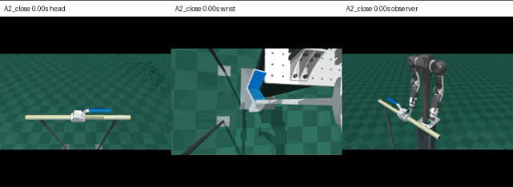
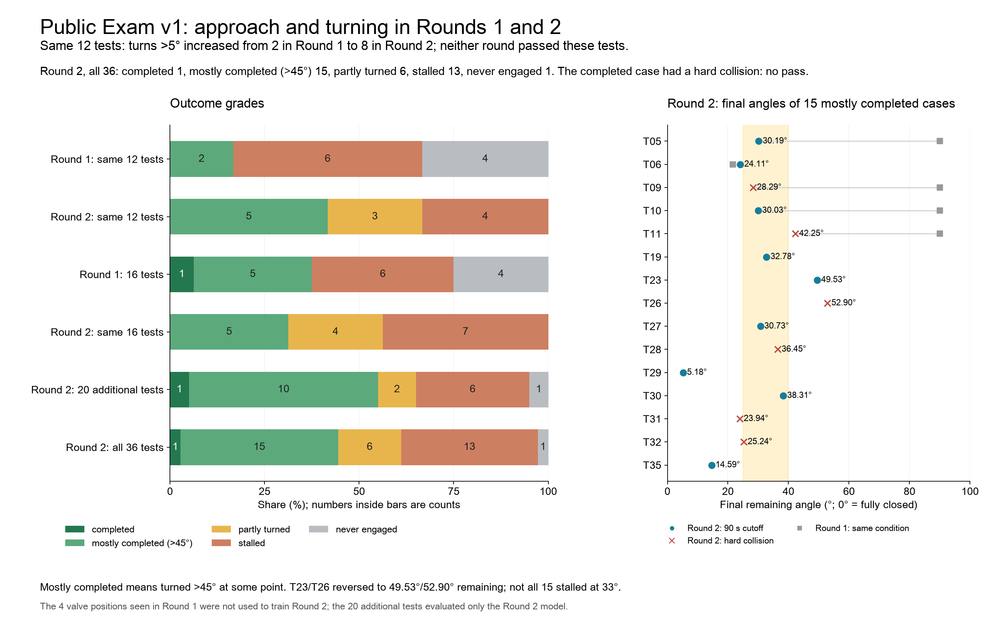
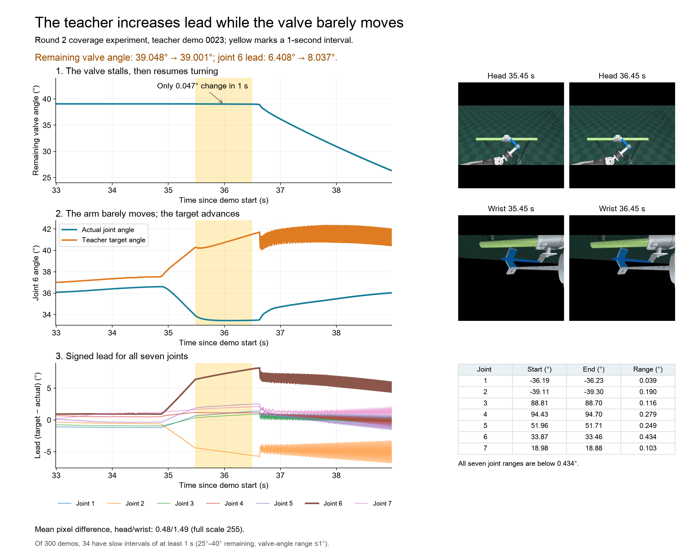
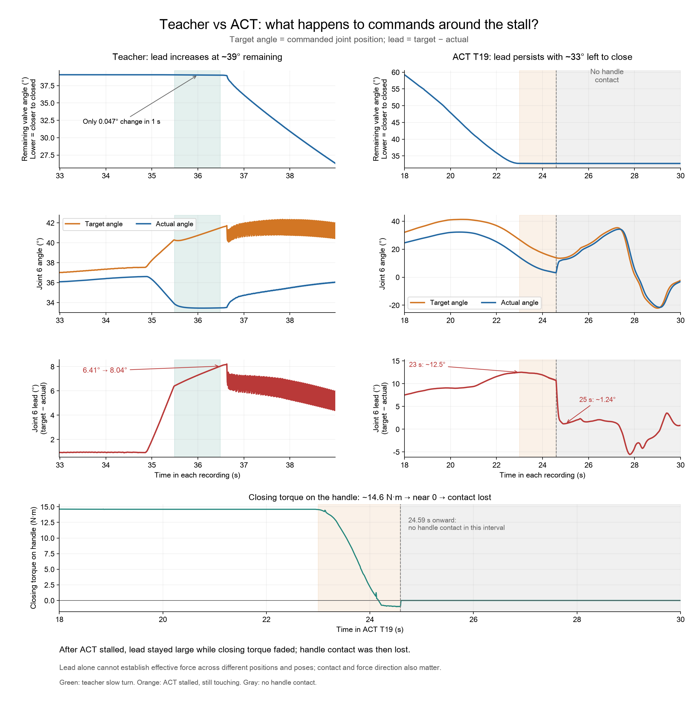
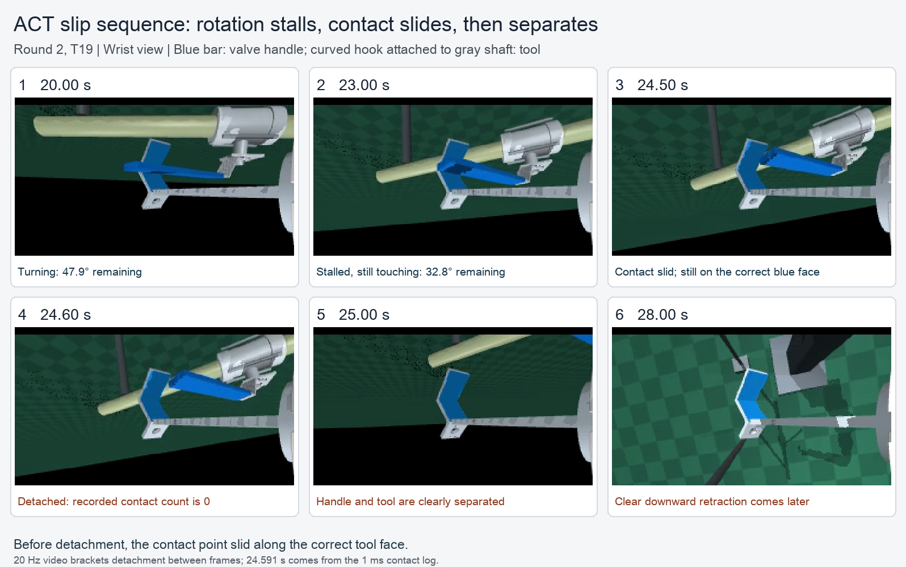

# ACT baseline: what we tried, what we saw, what we don't know yet

## TL;DR

**ACT learned to approach and turn the handle, but did not reliably close the valve.** In round 1, it passed 1/4 tests at seen valve positions and 0/12 held-out-position and appearance tests. Round 2 expanded scene coverage and passed 0/36 tests. The added coverage improved approach and turning. In test T19, the tool lost effective contact near the end of the stroke; why the policy produced that motion remains an open question.

*Round 1 ACT: closes the valve at a position used in training and fully retracts. Original speed, 30.6 seconds.*

## 1. Task and data

- **Task:** an OpenArm arm with an S-shaped hook/push tool closes a DN25 lever ball valve (station A2: horizontal pipe, top-mounted, handle swings right → front, pulled toward the body). The valve position is randomized within ±5 cm on each axis; breakaway resistance is 0.5–1.5× the reference value.
- **Teacher:** a scripted controller that reads valve pose and contacts. The A2-closing source batch has 261 successful records: 256 dataset demonstrations, 4 held-out tests, and 1 standard demonstration.
- **Public Exam v1:** end within 5° of the target stop, held continuously for the final 1 s; no hard collision with the environment; a 90-second cutoff. The [same rules](../levels/01-handle-ball-valve/#public-exam-v1) apply to any robot and end-effector. S-tool working-face checks are separate records and do not affect pass/fail.
- **Student (ACT):** ACT from LeRobot 0.6.1. Inputs: head and wrist camera images plus 7 left-arm joint angles. Output: joint position targets.

## 2. Two rounds

All 52 ACT tests were re-evaluated under Public Exam v1. Pass counts are unchanged.

| Round | Setup | Training and validation data | Result |
|---|---|---|---|
| 1 | 100k updates; re-predict every step with temporal ensembling; 100 Hz paired observations and actions | A2 close: 224 training demos at 7 positions; 32 validation demos at 1 separate position | Positions used in training: 1/4; unseen positions, including changed colors and lighting: 0/12 |
| 2 | **Data only:** one new random position and resistance per demo; same training settings | A2 close: 300 demos at 300 distinct positions, split into 240 training and 60 validation demos | 0/36 passes, but clearly better graded outcomes (below) |

The 12 tests use four valve positions excluded from training: four tests use the usual appearance, and eight apply two new color-and-lighting settings at each position. Round 2 repeats all 16 round-1 tests and adds 20 new valve positions; none of these positions was used to train the round-2 model.

Before round 2 we verified that dataset rendering and evaluation rendering use the same three-camera pipeline (81 image pairs, pixel-identical).

## 3. What we saw

### 3.1 Scene coverage was a real problem — more positions clearly improved the approach

On the same 12 tests (4 held-out-position tests and 8 appearance tests):

- "never engaged" dropped from 4 to 0;
- "turned more than 5°" rose from 2 to 8.

All 36 round-2 exams, graded: completed 1 (with a hard collision, so not a pass), mostly completed (>45°) 15, partly turned 6, stalled 13, never engaged 1.

**Lesson: many demos is not the same as many scenes.** The round-1 dataset contains 32 demos per valve position; those 32 look nearly identical to a camera.

### 3.2 The teacher pushes harder when stuck — and the camera can't see that

In demo 0023, with ~39° remaining, the valve moved only 0.047° in one second — images and joint angles barely changed. Yet the teacher's joint-6 *lead* (target angle minus actual angle) rose from 6.41° to 8.04°, and the valve started turning again. Increasing the lead makes the position controller apply more drive to the joint. Effective force on the handle also depends on contact and direction. 34 of 300 demos contain such slow-turn windows.

### 3.3 A typical failure: ACT does push, but the contact slides off and it lets go

Exam T19 ([record](../evaluations/round2/new_unseen_positions/coverage_test_A2_close_02_train_episode_0161/result.json)): round 2, fixture `coverage_test_A2_close_02`, zero-based `--case-index 18` in the [exam plan](../evaluations/round2/examination_plan.json).

- at ~23 s the valve stalls with 32.8° remaining;
- joint-6 lead is still ~12.5° — **ACT is not failing to push**;
- closing torque on the handle drops from ~14.6 N·m to near 0;
- the contact point slides ~2.4 cm outward along the tool, contact is lost at 24.591 s, then the arm retracts.

## 4. What we don't know yet

Plausible causes, not yet separated:

1. **Phase ambiguity:** one frame plus joint angles can't tell "how long have I been stuck" or "keep pushing vs. let go";
2. **Missing senses:** no joint velocity or motor current (force), which real robots already provide;
3. **Recovery data:** the dataset focuses on successful teacher runs, rather than explicit examples of disturbances and recovery;
4. **Prediction error at the most sensitive moment:** small errors during contact become a slip.

## 5. Open questions — come work on them

- Does adding joint velocity, motor current, or a short image history let ACT finish the stroke?
- Can the teacher decide how hard to push using only what the student can observe — a *learnable* teacher?
- What if vision handles approach and seating, and a simple force-controlled primitive does the final "push until it stops"?
- Do perturbation-and-recovery demos (DAgger-style) reduce slipping?

## 6. Release materials

The [runtime instructions](../runtime/README.md#read-data-and-run-act) give the ACT commands and identify the required local materials. In a clean macOS CPU environment, one fixed case from each round ran to completion. The [installation checks](../runtime/VALIDATION.md) are separate from the frozen benchmark results.

- **Demonstrations:** the 100 Hz, 646-record A1/A2 dataset and the separate 100 Hz, 300-record A2-closing coverage dataset. Their camera rates and splits are listed in the [dataset description](dataset_card.md).
- **In this repository:** [training configurations and curves](../models/#act-training-records-and-checkpoint-downloads), [the 52 exam results and the two exam plans](../evaluations/), and [28 fixed scene and initial-state bundles](../fixtures/).
- **v0 downloads:** the full datasets, both ACT checkpoints, and the raw exam records and videos. See the [download and placement instructions](../runtime/README.md#download-and-place-materials).

The [project home](../README.md) lists the release status.

## License

This report, its figures, and project-created videos are **CC BY 4.0**. Our ACT weights and code use **Apache-2.0**. Third-party material retains its original terms. See [license scope](../LICENSING.md) and [third-party notices](../THIRD_PARTY_NOTICES.md).
