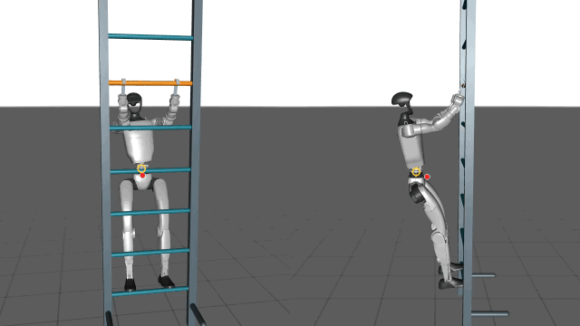

# Vertical ladder climbing

Valves in chemical plants are not always within arm's reach. Some sit above platforms or between pipes and require climbing to reach. We start with a vertical ladder to explore how robots can get to these locations.

## Demonstration and result

A G1 humanoid fitted with fixed S-hooks alternates hands and feet to climb in physics simulation. The GIF shows a successful run from the full starting pose at original speed.

*About 21 seconds. The two panels show the same run from two viewpoints. Red marks the whole-body center of mass; yellow marks the pelvis.*

**Test on 2026-11-05: 30 of 32 runs completed the specified alternating-climb sequence.** Every run began at the full starting pose on the same fixed ladder, with different random seeds and observation noise. This result covers that ladder.

## How it learns

1. **Prepare reference poses.** Use human climbing examples to arrange the hand changes, foot changes, and upward body movement, then pose the robot.
2. **Train in physics simulation.** Reinforcement learning learns corrections to the reference joint motions, coordinating hooks, foot placement, and body support.
3. **Test from the beginning.** Start at the full starting pose and check whether the robot completes the sequence, retaining failed runs as well.

## License

This guide and the project-created GIF are **CC BY 4.0**. The G1 model and the simulation framework retain their original licenses. See [license scope](../LICENSING.md) and [third-party notices](../THIRD_PARTY_NOTICES.md).
