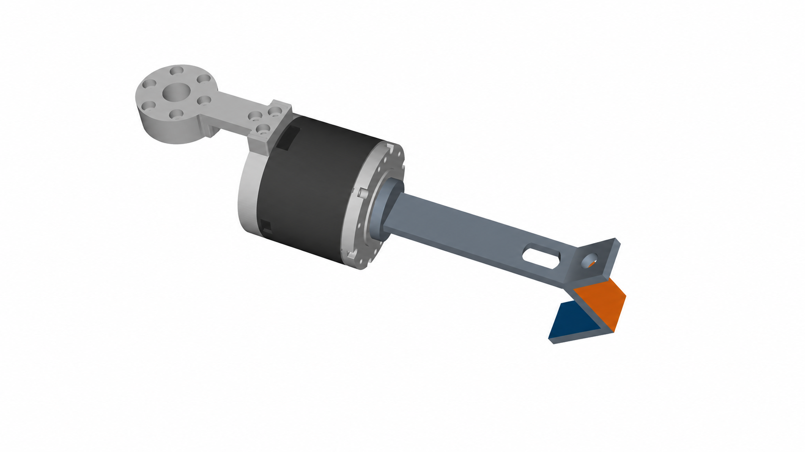
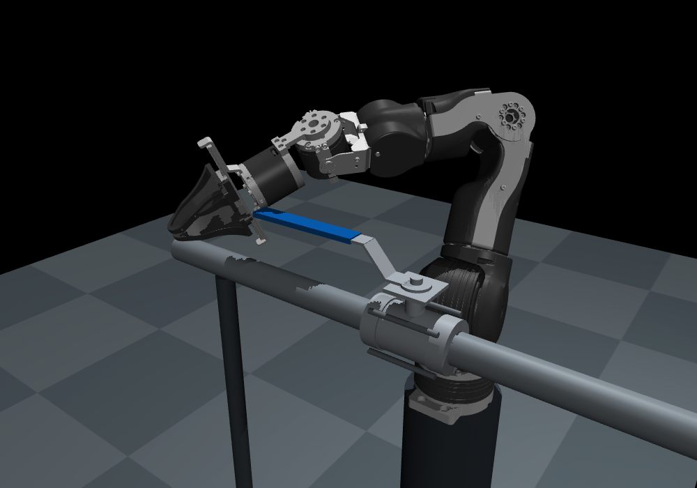
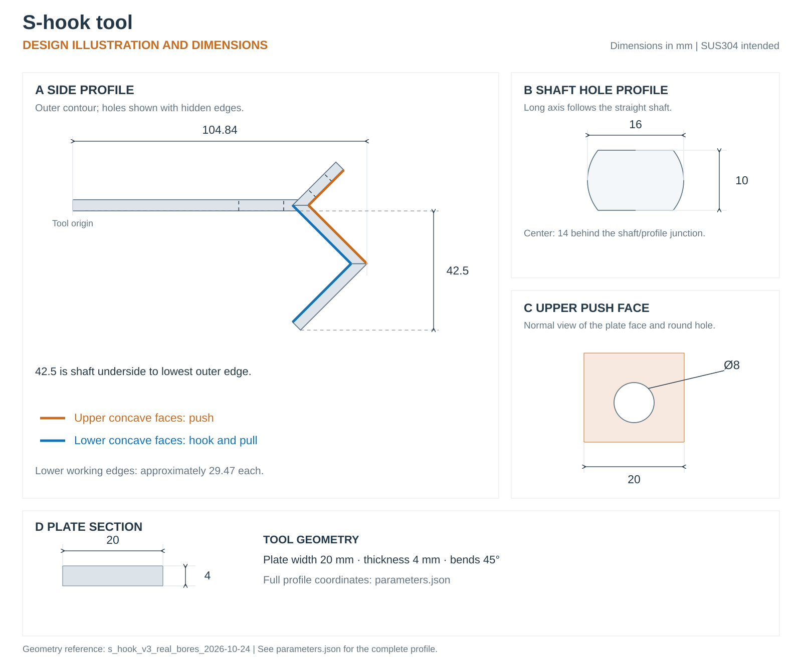

# S-hook tool

A fixed push-and-pull tool designed for **SUS304 stainless steel**. The upper concave faces push against a valve handle; the lower concave faces hook and pull it. Both functions use the same fixed structure, without moving fingers to squeeze the handle.

Assembly illustration: the OpenArm wrist is on the left, with a circular mount connecting it to the S-hook. The straight shaft has a flat-sided hole; the raised plate has a round hole. Orange marks the pushing faces, and blue marks the pulling faces.

## Why we designed it

In our early simulation, OpenArm's stock parallel gripper used its base beside the finger slide rail to push the handle. This setup stalled under higher valve resistance.

We need a palm-like surface to bear directly against the handle. Dexterous hands often put drive mechanisms in this space, and their cost is a poor fit for rough industrial work. We chose a simple, fixed tool for pushing and pulling.

## Drawing and parameters

- [Design drawing (SVG)](drawings/s-hook-simulation-dimensions.svg)
- [Geometry parameters (JSON)](parameters.json)

Dimensions are in millimeters. The drawing and parameters describe the simulation design.

| Feature | Value |
|---|---|
| Forward extent from the tool origin | 104.84 mm |
| Depth from the shaft's lower surface to the lowest outer edge | 42.5 mm |
| Plate width | 20 mm |
| Plate thickness | 4 mm |
| Two lower hook working edges | Approximately 29.47 mm each |
| Flat-sided hole in the straight shaft | 16 × 10 mm |
| Shaft-hole center | 14 mm behind the shaft/profile junction |
| Round hole in the upper plate | 8 mm diameter |
| Bend geometry | 45° |

[Back to Level 1](../../levels/01-handle-ball-valve/) · [Teacher](../../docs/teacher.md) · [Project home](../../README.md)

## License

The tool parameters are **Apache-2.0**. This guide, the SVG illustration, and project-created images are **CC BY 4.0**. Third-party material retains its original terms. See [license scope](../../LICENSING.md) and [third-party notices](../../THIRD_PARTY_NOTICES.md).
