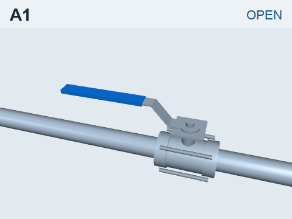
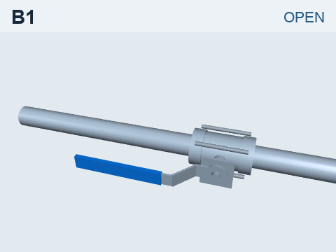
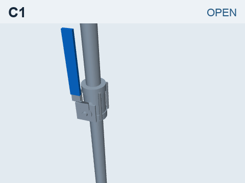
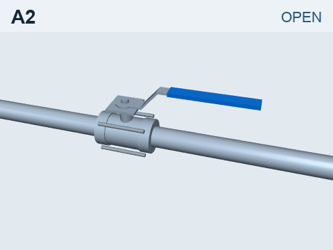
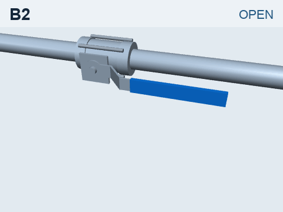
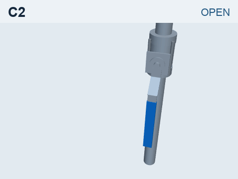

# Level 1: Handle ball valve

Operate a manual DN25 handle ball valve from the starting pose: use physical contact to reach and hold the fully open or fully closed position. Public Exam v1 applies to any robot and end-effector, including grippers, dexterous hands, and dedicated tools. The reference teacher uses OpenArm with a fixed S-shaped hook/push tool.

## Six stations

| Horizontal pipe, stem up | Horizontal pipe, stem facing operator | Vertical pipe, stem facing operator |
|:---:|:---:|:---:|
|  |  |  |
|  |  |  |

*Geometric opening and closing illustrations. Click a thumbnail for a larger view.*

| Stations | Installation | v0 coverage |
|---|---|---|
| A1, A2 | Horizontal pipe; upward-facing stem | Opening and closing reference demonstrations |
| B1, B2 | Horizontal pipe; operator-facing stem | Challenge stations; no reference solution |
| C1, C2 | Vertical pipe; operator-facing stem | Challenge stations; no reference solution |

The station and robot are separate. The [model library](../../models/) contains the valve parameters and six station models. Robot adapters connect models and contact records to the task; the public exam does not restrict which robot part or surface may contact the handle.

## Public Exam v1

The same three rules apply to **any robot, any end-effector, and any method**, including scripts, learned policies, and teleoperation:

1. **Reach and hold the endpoint.** At the end of the operation or episode cutoff, the valve must be within 5° of the target stop and have stayed there continuously for the final 1 second or longer. Reaching it earlier and then moving out of the target region does not pass.
2. **No hard collision with the environment.** Any robot part contacting a pipe, support, valve body, or other non-handle environment object with an individual contact force above 20 N fails. Any robot part or surface may contact the handle. Robot self-contact, including between fingers or between a finger and palm, is recorded and does not count as a hard collision.
3. **90-second cutoff.** End the episode at 90 seconds if the operation has not finished, and assess its state at that cutoff.

Valve motion must come from physical robot contact; directly overwriting its state is invalid. S-tool working-face checks are recorded separately and do not affect public pass/fail. Release and retraction are also recorded separately.

## Teacher and student

The **teacher** is a Python reference controller for **OpenArm + S-hook**. It follows human-reviewed key poses and uses actual simulator state to generate demonstrations. See [How the demonstrations are made](../../docs/teacher.md) for the workflow and control logic.

The **student**, ACT, learns from head and wrist images plus arm joint angles to predict joint targets. Its policy does not receive the true valve angle or contact force. Evaluation runs its own control loop from start to finish.

The first dataset contains **646 demonstrations: 619 complete reach-to-retract motions and 27 ending after the target hold**. The second ACT round uses a separate **300-demonstration A2-closing batch at 300 different positions**, all with complete retraction: 240 for training and 60 for validation. Fields, recording rates, and splits are in the [dataset card](../../docs/dataset_card.md).

We encoded known field technique in the teacher to generate demonstrations for ACT. The [S-hook page](../../hardware/s-hook/) explains the reference tool's design.

## Results

The results below were re-evaluated under Public Exam v1.

| Method | Inputs | Test | Public Exam v1 result |
|---|---|---|---|
| ACT, round 1: A2 close | Head + wrist images, joint angles | Seen valve positions | 1 / 4 |
| ACT, round 1: A2 close | Head + wrist images, joint angles | Valve positions not used in training; some tests change colors and lighting | 0 / 12 |
| ACT, round 2: A2 close | Head + wrist images, joint angles | More valve positions not used in training; some tests change colors and lighting | 0 / 36 |

The ACT round-1 pass at a seen position includes complete retraction. For the other 12 tests, four use valve positions excluded from training; eight more change colors and lighting at those same positions.

In round 2, the 36 runs were graded as **completed 1, mostly completed 15, partly turned 6, stalled 13, and never engaged 1**. The completed valve turn had a hard collision and did not pass. No round-2 run passed or completed a full retraction.

Rounds 1 and 2 each used 100,000 training updates, batch size 8, seed 1000, a new prediction at every control step, and temporal ensembling with coefficient 0.01. Round 2 changed the training data to cover more positions and resistance values. See the [ACT baseline](../../docs/act_baseline.md) for the comparisons and failure analysis.

- [Round 1 success: ACT closes A2 at a seen valve position and fully retracts, 30.6 seconds](../../assets/act-round1-a2-close-pass.mp4).
- [Round 1 failure: ACT at a held-out A2 position, hard collision, 39.25 seconds](../../assets/act-round1-a2-close-collision.mp4).

Both videos show actual policy-driven physics simulation, with three views at original speed. The homepage GIF is a separate teacher replay with illustrative industrial scenery.

## Known limitations

- The teacher is specific to OpenArm with the S-hook. A different robot or end-effector needs its own contact and control logic and reviewed key poses. B1–C2 have no reference solution yet.
- ACT rounds 1 and 2 cover A2 closing with head and wrist cameras. The other three tasks and the head-only comparison were not run in these rounds.

## Run it

Use the [installation and run commands](../../runtime/README.md#installation-and-commands) to load a station and run and score the A2 closing reference. The same command accepts `A1_open`, `A1_close`, `A2_open`, or `A2_close`. The [Python example](../../runtime/examples/openarm_simulation_step.py) initializes the bundled OpenArm and runs one simulation step. To connect another robot, see the [robot and task interface](../../runtime/README.md#robottask-api) and [exam recording format](../../runtime/README.md#scores-and-evidence).

The [ACT run commands](../../runtime/README.md#read-data-and-run-act) use a complete local material root with the corresponding dataset, checkpoint, and fixed test inputs. See the [dataset card](../../docs/dataset_card.md#reproduction-status) for what is included and the download status.

## License

Project-owned course text and explanatory illustrations use [CC BY 4.0](../../LICENSES/CC-BY-4.0.txt); attribute them to **Rusty Valve contributors**. Project-owned code, simulation model files and configurations, and ACT weights use Apache-2.0. Third-party materials retain their original licenses; see [Licensing](../../LICENSING.md) and [Third-party notices](../../THIRD_PARTY_NOTICES.md).

[Back to Rusty Valve](../../README.md)
