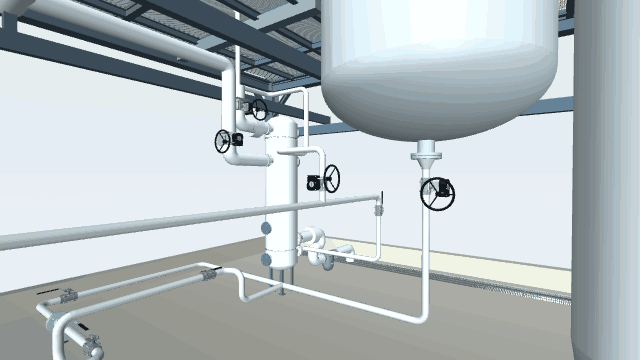
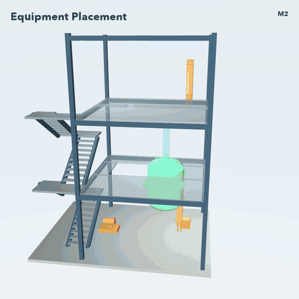

# Chemical plant rooms

[Rusty Valve](../../../README.md) · [Valves](../../valves/README.md)



15 ready-made rooms of a chemical plant: reactors and vessels, pumps, heat exchangers, pipes with insulation, steel platforms, stairs, and 304 manual valves you can turn. Each room opens in MuJoCo and in Isaac Sim. A generator builds more rooms from a short process recipe.

## Use a ready-made room

1. **Download** one room folder from [Hugging Face](https://huggingface.co/datasets/rusty-valve/chemical-plant-rooms/tree/main), for example `room-12`. Keep its files together.

   ```sh
   pip install -U huggingface_hub
   hf download rusty-valve/chemical-plant-rooms --repo-type dataset --include "room-12/*" --local-dir .
   ```

2. **Run it in MuJoCo** (Python 3.12 with `mujoco` and `numpy`):

   ```sh
   cd room-12
   python -B run_room.py            # viewer; on macOS use: mjpython -B run_room.py
   ```

   `run_room.py` applies each valve's opening and closing resistance at every step. To drive a robot, see `ROOM_SIMULATION.md` in the folder.

3. **Or open it in Isaac Sim:** open `room-12/usd/room.usd`. Each valve is a reference to its own valve asset and turns on its joint. For the resistance curve in Isaac Sim, use `isaac_valve.py` from the valve's folder in `valves/`.

4. **Find the valves:** `task_index.json` lists every valve in the room with its ID (`V001`, `V002`, …), model, size, position, turning axis, open and closed angles, and the nearest standing area.

[Watch a probe close a lever valve in room-12](https://huggingface.co/datasets/rusty-valve/chemical-plant-rooms/resolve/main/media/room-12-isaac-dn32-lever-close.mp4) · [and a handwheel valve](https://huggingface.co/datasets/rusty-valve/chemical-plant-rooms/resolve/main/media/room-12-isaac-dn50-handwheel-close.mp4)

## Rooms

| Room | Process layout |
|---|---|
| [room-01](https://huggingface.co/datasets/rusty-valve/chemical-plant-rooms/tree/main/room-01) | Gravity transfer between horizontal vessels |
| [room-02](https://huggingface.co/datasets/rusty-valve/chemical-plant-rooms/tree/main/room-02) | Two reactors gravity-feed a horizontal vessel |
| [room-03](https://huggingface.co/datasets/rusty-valve/chemical-plant-rooms/tree/main/room-03) | Single-reactor pumped recirculation with a horizontal steam heater |
| [room-04](https://huggingface.co/datasets/rusty-valve/chemical-plant-rooms/tree/main/room-04) | Two reactors feed one vessel under nitrogen pressure |
| [room-05](https://huggingface.co/datasets/rusty-valve/chemical-plant-rooms/tree/main/room-05) | Nitrogen-pressure transfer from a jacketed reactor to a horizontal vessel |
| [room-06](https://huggingface.co/datasets/rusty-valve/chemical-plant-rooms/tree/main/room-06) | Pumped transfer to a horizontal vessel with a steam-heated recirculation loop |
| [room-07](https://huggingface.co/datasets/rusty-valve/chemical-plant-rooms/tree/main/room-07) | Single-reactor pumped recirculation with a large horizontal steam heater |
| [room-08](https://huggingface.co/datasets/rusty-valve/chemical-plant-rooms/tree/main/room-08) | Nitrogen-pressure transfer to a large horizontal vessel |
| [room-09](https://huggingface.co/datasets/rusty-valve/chemical-plant-rooms/tree/main/room-09) | Gravity transfer from one horizontal vessel to two |
| [room-10](https://huggingface.co/datasets/rusty-valve/chemical-plant-rooms/tree/main/room-10) | Gravity transfer from a small horizontal vessel to a medium one |
| [room-11](https://huggingface.co/datasets/rusty-valve/chemical-plant-rooms/tree/main/room-11) | Pumped transfer between reactors with a filter bypass and steam heating |
| [room-12](https://huggingface.co/datasets/rusty-valve/chemical-plant-rooms/tree/main/room-12) | Single-reactor pumped recirculation with a vertical heater and condenser |
| [room-13](https://huggingface.co/datasets/rusty-valve/chemical-plant-rooms/tree/main/room-13) | Nitrogen-pressure transfer between two reactors |
| [room-14](https://huggingface.co/datasets/rusty-valve/chemical-plant-rooms/tree/main/room-14) | Gravity transfer between reactors, then pumped transfer to a horizontal vessel |
| [room-15](https://huggingface.co/datasets/rusty-valve/chemical-plant-rooms/tree/main/room-15) | Gravity transfer from a vertical reactor to a horizontal vessel |

<details>
<summary>Pipes and valves in each room</summary>

| Room | Pipes connected | Valves | Pipes left open |
|---|---:|---:|---|
| room-01 | 15/15 | 9 | — |
| room-02 | 24/29 | 19 | L003, L009, L019, L026, L027 |
| room-03 | 26/26 | 28 | — |
| room-04 | 29/29 | 21 | — |
| room-05 | 23/24 | 20 | L017 |
| room-06 | 34/34 | 33 | — |
| room-07 | 26/26 | 28 | — |
| room-08 | 24/24 | 22 | — |
| room-09 | 21/23 | 13 | L005, L006 |
| room-10 | 15/15 | 9 | — |
| room-11 | 31/31 | 29 | — |
| room-12 | 20/20 | 22 | — |
| room-13 | 17/21 | 15 | L003, L013, L015, L020 |
| room-14 | 32/34 | 26 | L006, L031 |
| room-15 | 15/15 | 10 | — |

</details>

## Generate your own room



The generator reads a process recipe, such as "one reactor, pumped back to itself through a steam heater", and builds the room around it: it picks and places the equipment, routes the pipes, fits the valves, adds insulation, then platforms, stairs, and floor.

1. **Get the generator.** The code is in [`generator/`](../../../generator/) in this repository. Download [`generator_runtime/`](https://huggingface.co/datasets/rusty-valve/chemical-plant-rooms/tree/main/generator_runtime) (equipment and valve models) and put it next to `scene_gen/`, or point the `SCENE_GEN_RUNTIME` environment variable at it.

   ```sh
   cd generator
   python3.12 -m venv .venv && . .venv/bin/activate
   python -m pip install -r scene_gen/requirements.txt
   ```

2. **Rebuild a room from its recipe.** Every room folder has a `recipe.json`. Keep the `recipe_reference/` folder beside it, which holds the saved equipment positions:

   ```sh
   python -B -m scene_gen.room generate --recipe /path/to/room-12/recipe.json --out ./my_room_12
   ```

3. **Change the recipe.** Copy `recipe.json` and edit it: the vessels and how material moves between them, the number of bays and platform levels, the floor height, or the height of the containment curb. Run the same command with a new output folder. If you change the floor height or the equipment, delete `equipment_reference` from the copy so the generator places the equipment again.

**About the seed.** The generator tries equipment positions in an order set by a number, the `seed` in the recipe. The same recipe with the same seed repeats the same attempts and gives the same room. Change the seed to get a different arrangement of the same process.

Expect several minutes and up to 3 GB of memory per room. Not every recipe and seed connects every pipe; the run log says which pipes are still open.

## Good to know

- Valve standing areas come from a geometry check of the room, not from a robot trial. Check reach with your own robot.
- Relief valves are not operable; some are drawn as simple boxes.

Room models, recipes, and code: Apache-2.0. [License scope](../../../LICENSING.md)
