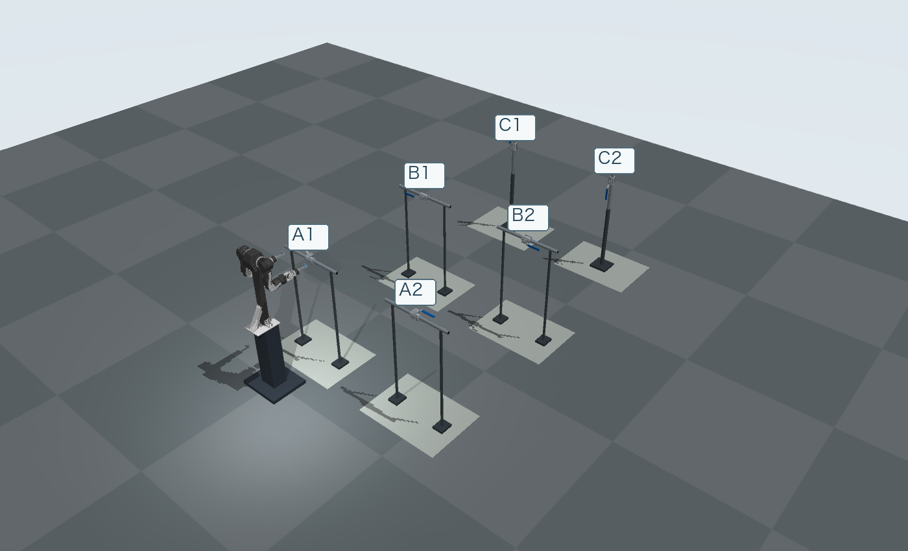

# Handle ball-valve stations

Six MuJoCo scenes, each containing a generic DN25 handle ball valve, a pipe section, supports, and a floor. The scenes are saved separately from the robot model. Each XML includes contact geometry and loads without external meshes, textures, or absolute asset paths.

## Choose a station

<a href="../../../assets/station-layouts.png"></a>

*The six stations together, with OpenArm at A1. Click to enlarge.*

| Station | Installation | Fully open → fully closed handle direction | Files |
|---|---|---|---|
| A1 | Horizontal pipe; upward-facing stem | Left → back | [MJCF](A1.xml) · [Parameters](A1.json) |
| A2 | Horizontal pipe; upward-facing stem | Right → front | [MJCF](A2.xml) · [Parameters](A2.json) |
| B1 | Horizontal pipe; operator-facing stem | Left → up | [MJCF](B1.xml) · [Parameters](B1.json) |
| B2 | Horizontal pipe; operator-facing stem | Right → down | [MJCF](B2.xml) · [Parameters](B2.json) |
| C1 | Vertical pipe; operator-facing stem | Up → right | [MJCF](C1.xml) · [Parameters](C1.json) |
| C2 | Vertical pipe; operator-facing stem | Down → left | [MJCF](C2.xml) · [Parameters](C2.json) |

Directions use the station convention: left is world +Y, right is −Y, back is +X, front is −X, and up is +Z. They do not change with the viewing camera. See the [course illustrations](../../../levels/01-handle-ball-valve/).

## Load a model

With MuJoCo installed, run from the repository root:

```python
import mujoco

model = mujoco.MjModel.from_xml_path(
    "models/scenes/handle-ball-valve-stations/A1.xml"
)
data = mujoco.MjData(model)
```

Each scene has one passive hinge and zero actuators. It does not turn the valve by itself. A robot or another physical interaction must supply the operating force.

The hinge is named `{station}_valve_hinge`, for example `A1_valve_hinge`. Its coordinate is `0` when fully open and `pi/2` (90°) when fully closed, in radians. Increasing the coordinate closes about the negative outward stem axis. The `environment_open` and `environment_closed` keyframes provide the two geometric endpoint states; they are not recorded successful operations.

The companion JSON specifies the valve location and axes, geometry, pipe dimensions, supports, permitted fixed-base reference region, physics settings, and resistance parameters. The XML contains the configured physical scene, including enabled contact geometry. Dimensions use metres; joint angles use radians.

## Resistance and assumptions

The XML fixes the hinge's passive friction bound at **14 N·m**. Resistance that changes with valve angle and turning direction requires runtime code, which is not included in these model files. The companion JSON records the profile settings and sources.

The valve has a simplified exterior based on selected Bray DN25 dimensions. Geometry details, mass and inertia, contact friction, and installation layout use task assumptions. The model has not been calibrated against measurements of a real valve and does not simulate fluid, pressure, leakage, wear, or temperature. See the [valve parameter notes](../../valves/dn25-handle-ball-valve/) for sources.

For complete operation tasks, the [runtime](../../../runtime/README.md) supplies robot integration, motion control, resistance updates, recording, and scoring. The reference controller covers opening and closing at A1 and A2. B1–C2 are challenge stations without a reference solution.

## File check

All six XML files passed independent loading with MuJoCo 3.3.4: each has one hinge, zero actuators, no external file references, and enabled contact geometry.

## License

Our station XML and JSON files are **Apache-2.0**. This guide and project-created illustrations are **CC BY 4.0**; depicted third-party models retain their original terms. See [license scope](../../../LICENSING.md) and [third-party notices](../../../THIRD_PARTY_NOTICES.md).
