# Valves

[Rusty Valve](../../README.md) · [Rooms](../scenes/chemical-plant-rooms/README.md)

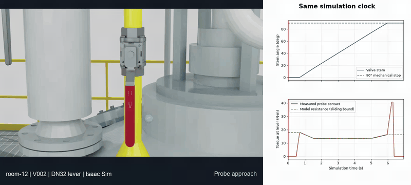

*A probe pushes the lever of a DN32 ball valve closed in Isaac Sim. Right: stem angle and torque at the lever.*

17 manual ball valves from DN15 to DN200, turned by a lever or a gearbox handwheel. Each valve turns on a joint between its open and closed stops, and pushes back like a real one: hard to start, easier while turning, and harder again just before it closes.

**Download:** [all 17 valves on Hugging Face](https://huggingface.co/datasets/rusty-valve/valve-models/tree/main). Each folder is one valve.

## Models

| | Model | Size | Operator | Pipe ends |
|---|---|---|---|---|
| 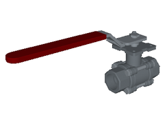 | [Bray 7000 three-piece](https://huggingface.co/datasets/rusty-valve/valve-models/tree/main/bray-7000-dn015-npt-lever) | DN15 | Lever | 1/2" NPT threaded |
| 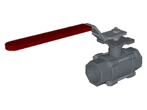 | [Bray 7000 three-piece](https://huggingface.co/datasets/rusty-valve/valve-models/tree/main/bray-7000-dn020-npt-lever) | DN20 | Lever | 3/4" NPT threaded |
| 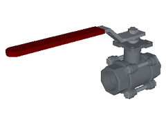 | [Bray 7000 three-piece](https://huggingface.co/datasets/rusty-valve/valve-models/tree/main/bray-7000-dn025-npt-lever) | DN25 | Lever | 1" NPT threaded |
| 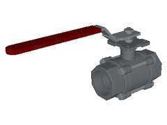 | [Bray 7000 three-piece](https://huggingface.co/datasets/rusty-valve/valve-models/tree/main/bray-7000-dn032-npt-lever) | DN32 | Lever | 1-1/4" NPT threaded |
| 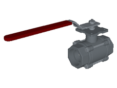 | [Bray 7000 three-piece](https://huggingface.co/datasets/rusty-valve/valve-models/tree/main/bray-7000-dn040-npt-lever) | DN40 | Lever | 1-1/2" NPT threaded |
| 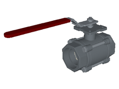 | [Bray 7000 three-piece](https://huggingface.co/datasets/rusty-valve/valve-models/tree/main/bray-7000-dn050-npt-lever) | DN50 | Lever | 2" NPT threaded |
| 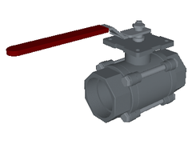 | [Bray 7000 three-piece](https://huggingface.co/datasets/rusty-valve/valve-models/tree/main/bray-7000-dn065-npt-lever) | DN65 | Lever | 2-1/2" NPT threaded |
| 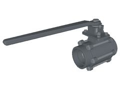 | [Bray 7000 three-piece](https://huggingface.co/datasets/rusty-valve/valve-models/tree/main/bray-7000-dn080-npt-lever) | DN80 | Lever | 3" NPT threaded |
| 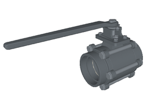 | [Bray 7000 three-piece](https://huggingface.co/datasets/rusty-valve/valve-models/tree/main/bray-7000-dn100-npt-lever) | DN100 | Lever | 4" NPT threaded |
| 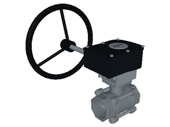 | [Bray 7100 with FTG42L gearbox](https://huggingface.co/datasets/rusty-valve/valve-models/tree/main/bray-7100-dn050-npt-ftg42l) | DN50 | Handwheel | 2" NPT threaded |
| 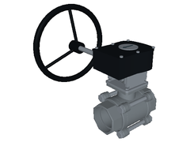 | [Bray 7100 with FTG42L gearbox](https://huggingface.co/datasets/rusty-valve/valve-models/tree/main/bray-7100-dn065-npt-ftg42l) | DN65 | Handwheel | 2-1/2" NPT threaded |
| 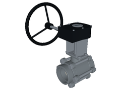 | [Bray 7100 with FTG42L gearbox](https://huggingface.co/datasets/rusty-valve/valve-models/tree/main/bray-7100-dn080-npt-ftg42l) | DN80 | Handwheel | 3" NPT threaded |
| 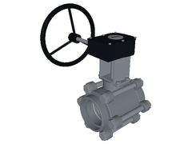 | [Bray 7100 with FTG42L gearbox](https://huggingface.co/datasets/rusty-valve/valve-models/tree/main/bray-7100-dn100-npt-ftg42l) | DN100 | Handwheel | 4" NPT threaded |
| 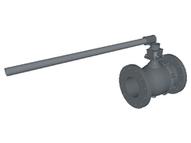 | [Bray F30 flanged](https://huggingface.co/datasets/rusty-valve/valve-models/tree/main/bray-f30-dn150-class300-rf-lever) | DN150 | Long lever | Class 300 RF flange |
| 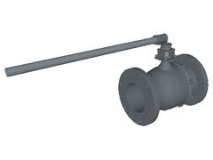 | [Bray F30 flanged](https://huggingface.co/datasets/rusty-valve/valve-models/tree/main/bray-f30-dn200-class300-rf-lever) | DN200 | Long lever | Class 300 RF flange |
| 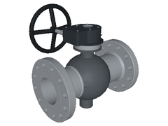 | [Cameron T31 trunnion](https://huggingface.co/datasets/rusty-valve/valve-models/tree/main/cameron-t31-dn150-class600-rf-dt21) | DN150 | Gearbox handwheel | Class 600 RF flange |
| 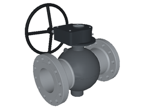 | [Cameron T31 trunnion](https://huggingface.co/datasets/rusty-valve/valve-models/tree/main/cameron-t31-dn200-class600-rf-dt40) | DN200 | Gearbox handwheel | Class 600 RF flange |

## Formats

| Use with | Files |
|---|---|
| MuJoCo | `model.xml`, plus the resistance helper listed in each valve’s README |
| Isaac Sim (OpenUSD) | `valve.usd`, and `isaac_valve.py` for the resistance curve |
| CAD tools | `valve.step` |
| Any | `params.json`: dimensions, motion, resistance, and the source page of every value |

## Turn a valve

**MuJoCo.** Look at it: `python -m mujoco.viewer --mjcf=bray-7000-dn050-npt-lever/model.xml`. For lever valves, run this example from the downloaded valve folder to step the model with its resistance curve:

```python
from pathlib import Path
from mujoco_valve import Placement, assemble_station, advance_station

model, data, valves = assemble_station(Path("."), [Placement("v1", openness=1.0)])
for _ in range(2000):
    # set your robot's controls here
    advance_station(model, data, valves)   # updates resistance, then steps MuJoCo
```

For handwheel valves, keep `Placement` from `mujoco_valve`. Import `assemble_station` and `advance_station` from `dn50_mujoco` for Bray 7100 or `cameron_t31_mujoco` for Cameron T31. The valve package README names the helper.

**Isaac Sim.** From the Isaac Sim installation directory:

```sh
./python.sh /path/to/bray-7000-dn050-npt-lever/isaac_valve.py --direction close
```

The README in each valve folder shows how to add the same resistance to your own scene.

The stem joint reads 0 when fully open and 90° when fully closed. Each valve's axes and turning direction are in its `params.json`.

## Where the numbers come from

- **Dimensions** are taken from the manufacturers' published catalogs and manuals, page by page.
- **Geometry** is our own CAD rebuilt from those dimensions. No manufacturer CAD is included.
- **Resistance** uses the manufacturer's published stem torque, for example 41 N·m for the DN50 lever valve with no line pressure, and the manufacturer's typical start, running, and end factors. Handwheel torque is converted through the gearbox ratio.
- **Not yet measured on real valves.** We plan to record torque through the full stroke on real valves and calibrate the curves.

Reference documents: [Bray 7000/8000 catalog](https://www.bray.com/docs/default-source/brochures/product-brochures/three-piece-ball-valves-7000-8000-pb-en-us.pdf) · [Bray 7000/8000 manual](https://www.bray.com/docs/default-source/manuals-guides/iom-manuals/en-iom-2301-s7000-8000.pdf) · [Bray FTG gear operators](https://www.bray.com/docs/default-source/brochures/product-brochures/manual-operators-ftg-series-pb-en-us.pdf) · [Bray F15/F30 catalog](https://www.bray.com/docs/default-source/brochures/product-brochures/en-f-2400-f15-30-asme.pdf) · [Bray ball valve torque guide](https://www.bray.com/docs/default-source/technical-bulletin/en_tb-1005_act-selectguide-ball-valves.pdf) · [Cameron ball valve torque table (archived)](https://web.archive.org/web/20060313120138id_/http://www.coopercameron.com/cgi-bin/ccvalve/products/torkcbv.cfm). Rusty Valve is not affiliated with these manufacturers.

## Coming next

- Torque measured on real valves.
- Gate and globe valves with multi-turn handwheels, butterfly valves, needle valves for sampling, and handle-less ball valves turned with a wrench.
- Stuck and rusted valves, and valves under line pressure.

Have a valve, a photo, or a torque reading from a plant? [Share it](../../CONTRIBUTING.md).

The [DN25 valve used in Level 1](dn25-handle-ball-valve/README.md) is a simpler generic valve based on the same catalog, built into the six Level 1 stations.

Models and parameter files: Apache-2.0. [License scope](../../LICENSING.md)
